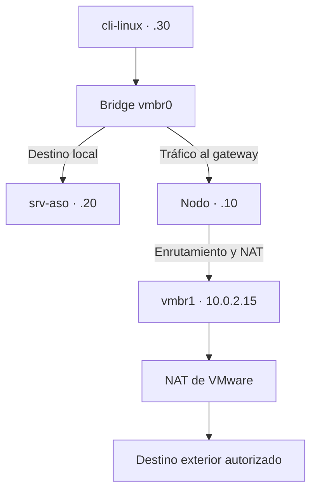

# 02-diagrama-red

## Objetivo
Diseñar la arquitectura de red lógica y física para el nodo Proxmox y el laboratorio del servicio ASO. El propósito principal es garantizar la conectividad para la gestión del hipervisor.

## Tabla Diseño de red
| Elemento | Nombre | IP | Función | Recursos |
|---|---|---|---|---|
| Nodo Proxmox | `pve-marhuenda` | 192.168.56.10 | Hipervisor | Máquina virtual |
| Servidor ASO | `srv-aso` | 192.168.56.20 | Servicio principal | Máquina virtual |
| Cliente | `cli-linux` | 192.168.56.30 | Pruebas | Máquina virtual |

## Nombre del nodo Proxmox
`pve-marhuenda`

## Hipervisor
**VMware**

## Red o VLAN de laboratorio
* Host-only --> 192.168.56.0/24
* Red NAT --> 10.0.2.0/24

## IPs de las VMs/LXC
Máquina con proxmox (`Nodo proxmox`): `192.168.56.10`
Servidor ASO (`srv-aso`): `192.168.56.20`
Cliente: `192.168.56.30`

## Gateway y DNS
**Red** | **Gateway** | **DNS**
|---|---|---|
| Host-only 192.168.56.0/24 | ... | ... |
| Red NAT 10.0.2.0/24| `10.0.2.1` | `10.0.2.1`, `8.8.8.8` |

## Bridge de Proxmox y interfaces
*  **`vmbr0`:** (Host only 192.168.56.0/24) | `192.168.56.10` | Para conectarnos a la web de proxmox a través del puerto TCP: 8006 con https.
*  **`vmbr1`:** (Red NAT: 10.0.2.0/24) | `10.0.2.1` | Salida a internet (Con el exterior de la red).

## Puertos necesarios
| Origen | Destino | Puerto | Función |
| --- | --- | --- | --- |
| **Equipo Anfitrión** (`192.168.56.1`) | **Nodo Proxmox** (`192.168.56.10`) | TCP 8006 | Acceso HTTPS a la interfaz web de administración de Proxmox. |
| **Equipo Anfitrión** (`192.168.56.1`) | **Nodo Proxmox** (`192.168.56.10`) | TCP 22 | Administración remota por consola SSH del hipervisor. |
| **Cliente** (`192.168.56.30`) | **Servidor ASO** (`192.168.56.20`) | TCP 22 | Administración interna y conexión SSH entre máquinas del laboratorio. |
| **Cliente** (`192.168.56.30`) | **Servidor ASO** (`192.168.56.20`) | TCP 80 / 443 | Consumo y verificación del servicio ASO principal |
| **VMs / Nodo Proxmox** | **Gateway NAT / DNS** (`10.0.2.1` / `8.8.8.8`) | UDP / TCP 53 | Consultas y resolución de nombres de dominio enviadas hacia el exterior de la red. |
| **Red NAT** (`10.0.2.0/24`) | **Internet** (Exterior) | TCP 80 / 443 | Salida exterior para la descarga de paquetes, plantillas e instalación de actualizaciones. |

## Diagrama de red

## Conclusión

Este diseño de red resuelve perfectamente las necesidades del proyecto virtualizado sobre VMware. 

Por un lado, el uso de la red **Host-only** (`vmbr0`) garantiza un entorno propio aislado y seguro: permite administrar Proxmox desde mi equipo físico y asegurar que el servidor ASO y el cliente se comuniquen entre sí sin interferir con la red exterior. 

Por otro lado como se necesita acceso a internet (al exterior), la red **NAT** (`vmbr1`) actúa como una especie de pasarela controlada, otorgando al nodo Proxmox y a sus máquinas el acceso a Internet para descargar paquetes y actualizaciones. 

[Volver al indice](../README.md)