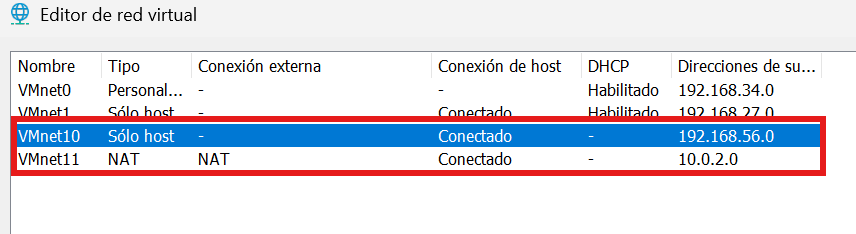
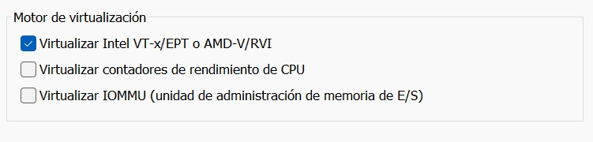
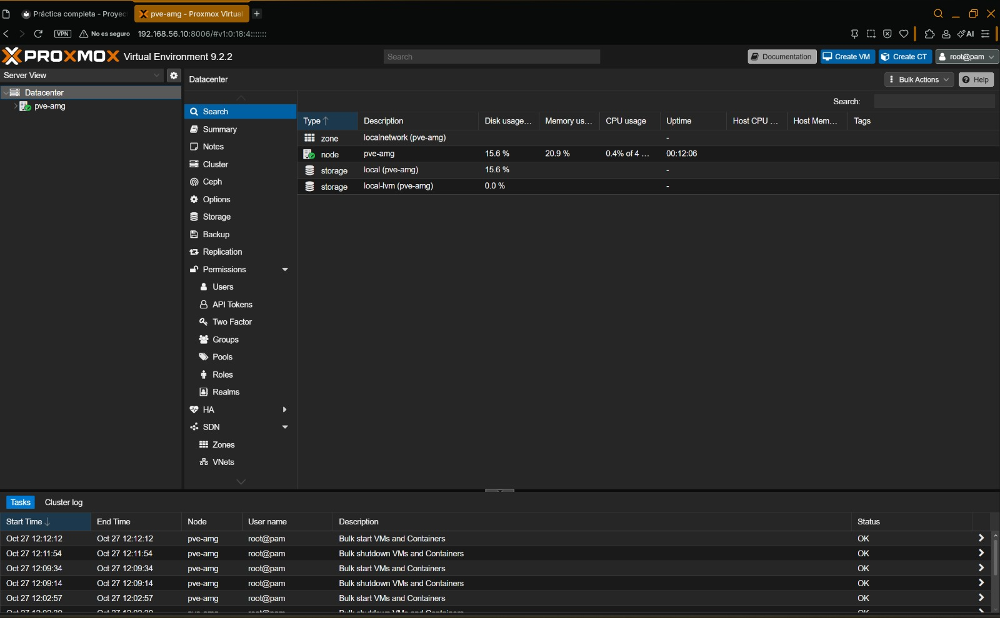

# 03-instalacion-proxmox

## Objetivo
Instalación máquina proxmox y configuración.

## Procedimiento

### 1. Abre VMware en tu equipo y registra su version.
- VMware Workstation Pro 26H1 -->
[Versión VMware](../evidencias/Sesion04/capturas-o-salidas/04img1.png)

### 2-3. Crea una VM Linux de 64 bits para Proxmox con CPU, RAM y VDI del diseno.
#### Según: [Requisitos recomendados](./01-inventario-hardware.md#1-puedo-instalar-proxmox-en-este-equipo)
#### Al crear la máquina se le asigna:
- SO: Debian 13x 64 bits --> [Sistema operativo](../evidencias/Sesion04/capturas-o-salidas/04img2.jpeg)
- CPU: 1 Procesador, 4 Núcleos --> [Procesadores asignados](../evidencias/Sesion04/capturas-o-salidas/04img3.jpeg)
- RAM: 8 GB de RAM --> [RAM Asignada](../evidencias/Sesion04/capturas-o-salidas/04img4.jpeg)
- VDI: 64 GB --> [Espacio disco asignado](../evidencias/Sesion04/capturas-o-salidas/04img5.jpeg)

### 4. Configura los adaptadores NAT y solo-anfitrion conforme al diseño local.
### Creación adaptadores: Según --> [Diseño de red](./02-diagrama-red.md)
Se usará **VMnet10** para la interfaz ``vmbr0`` y **VMnet11** para la interfaz ``vmbr1``
<br>
[Adaptadores creados según el diseño de red](../evidencias/Sesion04/capturas-o-salidas/04img6.png)<br>

Añadimos dos adaptadores de red a la máquina proxmox, uno con **VMnet10** y otro con **VMnet11**.

### 5. Con la VM apagada, habilita virtualizacion anidada si esta disponible y necesitas VMs KVM internas; comprueba luego su funcionamiento real.
### Activar virtualización anidada en VMware
<br>
[Virtualización anidada](../evidencias/Sesion04/capturas-o-salidas/04img7.jpeg)

### 6. Monta la ISO autorizada e instala Proxmox dentro del VDI, no sobre el host.
Montamos la ISO de **proxmox** ``(proxmox-ve_9.2-1.iso)`` en la máquina virtual.<br>
[ISO](../evidencias/Sesion04/capturas-o-salidas/04img8.jpeg)

**Proxmox instalado:** [Proxmox](../evidencias/Sesion04/capturas-o-salidas/04img9.jpeg)

### 7. Configura IP de gestion, hostname y DNS; abre el panel desde el navegador del mismo equipo anfitrion.
Configuramos la dirección IP y el puente al adaptador de red ``VMnet10`` que tiene la red "only-host". El DNS correspondiente y el hostname en /etc/hostname y vinculamos el hostname a mi IP local en /etc/hosts.<br>
[Configuración IP](../evidencias/Sesion04/capturas-o-salidas/04img10.jpeg)<br>
[Configuración DNS](../evidencias/Sesion04/capturas-o-salidas/04img11.jpeg)<br>

### Entramos al panel desde el equipo anfitrión
[Panel general PROXMOX](../evidencias/Sesion04/capturas-o-salidas/04img12.jpeg)
<br>

[Panel Red](../evidencias/Sesion04/capturas-o-salidas/04img13.jpeg)

[Panel almacenamiento](../evidencias/Sesion04/capturas-o-salidas/04img14.jpeg)

## Comandos usados

```bash
hostnamectl
ip -br addr
pveversion
df -h
```
### Salidas en:
- [hostnamectl](../evidencias/Sesion04/capturas-o-salidas/hostname.txt)
- [ip -br addr](../evidencias/Sesion04/capturas-o-salidas/conf_red.txt)
- [pveversion](../evidencias/Sesion04/capturas-o-salidas/pveversion.txt)
- [df -h](../evidencias/Sesion04/capturas-o-salidas/inf_discos.txt)

## Evidencias

- [Versión VMware](./Sesion04/capturas-o-salidas/04img1.png)
- [Sistema operativo](./Sesion04/capturas-o-salidas/04img2.jpeg)
- [Procesadores](./Sesion04/capturas-o-salidas/04img3.jpeg)
- [RAM](./Sesion04/capturas-o-salidas/04img4.jpeg)
- [Espacio Disco duro](./Sesion04/capturas-o-salidas/04img5.jpeg)
- [Adaptadores de red](./Sesion04/capturas-o-salidas/04img6.png)
- [Virtualización anidada](./Sesion04/capturas-o-salidas/04img7.jpeg)
- [ISO](./Sesion04/capturas-o-salidas/04img8.jpeg)
- [Proxmox interfaz de comandos](../evidencias/Sesion04/capturas-o-salidas/04img9.jpeg)
- [Configuración IP](../evidencias/Sesion04/capturas-o-salidas/04img10.jpeg)
- [Configuración DNS](../evidencias/Sesion04/capturas-o-salidas/04img11.jpeg)
- [Panel Red](../evidencias/Sesion04/capturas-o-salidas/04img13.jpeg)
- [Panel almacenamiento](../evidencias/Sesion04/capturas-o-salidas/04img14.jpeg)
- [hostnamectl](../evidencias/Sesion04/capturas-o-salidas/hostname.txt)
- [conf_red](../evidencias/Sesion04/capturas-o-salidas/conf_red.txt)
- [pveversion](../evidencias/Sesion04/capturas-o-salidas/pveversion.txt)
- [inf_disco](../evidencias/Sesion04/capturas-o-salidas/inf_discos.txt)

## Incidencias
Es necesario desactivar características de windows específicas relacionadas con Hyper-V y la virtualización. Para poder realizar virtualización anidada desde el software de virtualización.

## Conclusion
Se ha creado la máquina y los adaptadores de red, se ha instalado proxmox y configurado con éxito. Se accedió al panel de Proxmox desde el sistema anfitrión y se confirmó la conexión.

----------------------------------------------------

[Volver al indice](../README.md)
