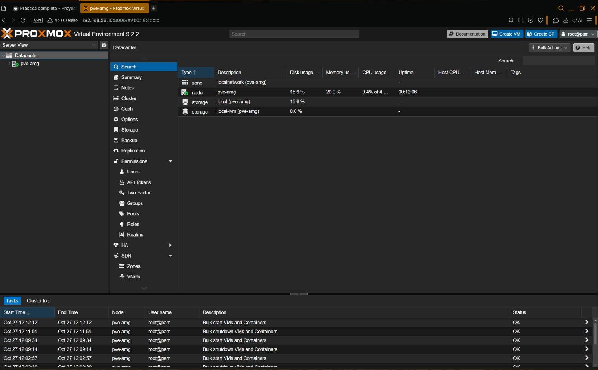
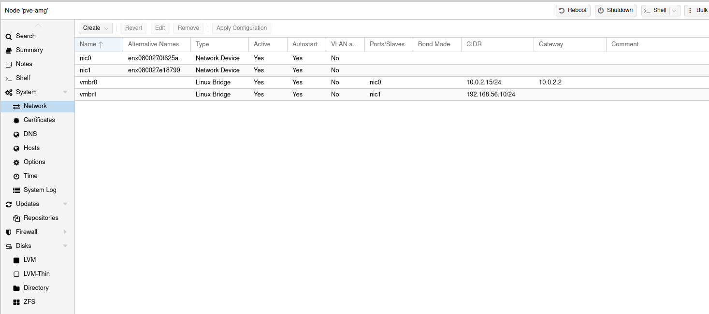
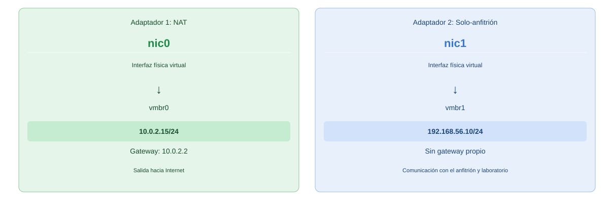
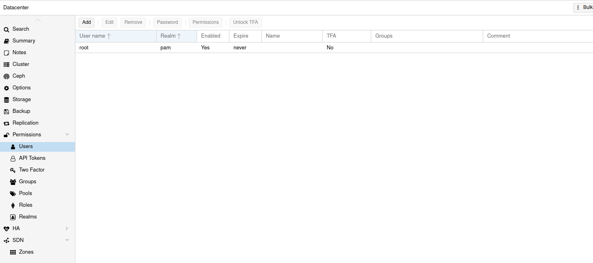
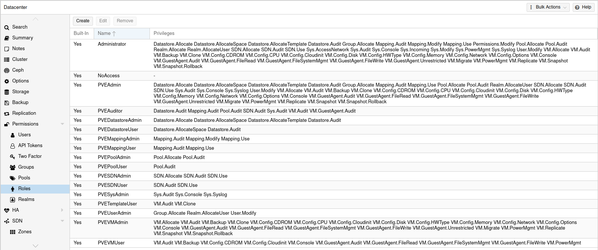
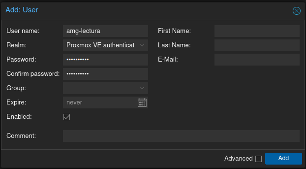
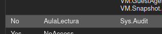
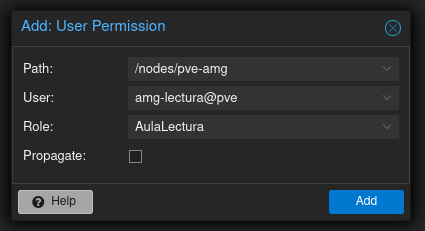
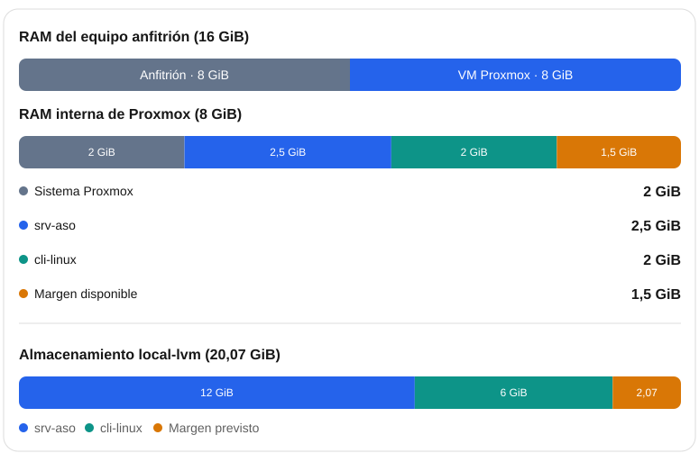

# 03-instalacion-proxmox

# Fase 3. Instalación de Proxmox

## Objetivo
Instalación máquina proxmox y configuración.

## Procedimiento

### 1. Abre VirtualBox en tu equipo y registra su version.
- Oracle VirtualBox -->
[Versión VirtualBox](../evidencias/Sesion04_05/capturas-o-salidas/04img1.png)

### 2-3. Crea una VM Linux de 64 bits para Proxmox con CPU, RAM y VDI del diseno.
#### Según: [Requisitos recomendados](./01-inventario-hardware.md#1-puedo-instalar-proxmox-en-este-equipo)
#### Al crear la máquina se le asigna:
- SO: Debian 13x 64 bits --> [Sistema operativo](../evidencias/Sesion04_05/capturas-o-salidas/04img2.jpeg)
- CPU: 1 Procesador, 4 Núcleos --> [Procesadores asignados](../evidencias/Sesion04_05/capturas-o-salidas/04img3.jpeg)
- RAM: 8 GB de RAM --> [RAM Asignada](../evidencias/Sesion04_05/capturas-o-salidas/04img4.jpeg)
- VDI: 64 GB --> [Espacio disco asignado](../evidencias/Sesion04_05/capturas-o-salidas/04img5.jpeg)

### 4. Configura los adaptadores NAT y solo-anfitrion conforme al diseño local.
### Creación adaptadores: Según --> [Diseño de red](./02-diagrama-red.md)
Se usará **VMnet10** para la interfaz ``vmbr0`` y **VMnet11** para la interfaz ``vmbr1``
<br>
[Adaptadores creados según el diseño de red](../evidencias/Sesion04_05/capturas-o-salidas/04img6.png)<br>

Añadimos dos adaptadores de red a la máquina proxmox, uno con **VMnet10** y otro con **VMnet11**.

### 5. Con la VM apagada, habilita virtualizacion anidada si esta disponible y necesitas VMs KVM internas; comprueba luego su funcionamiento real.
### Activar virtualización anidada en VMware
<br>
[Virtualización anidada](../evidencias/Sesion04_05/capturas-o-salidas/04img7.jpeg)

### 6. Monta la ISO autorizada e instala Proxmox dentro del VDI, no sobre el host.
Montamos la ISO de **proxmox** ``(proxmox-ve_9.2-1.iso)`` en la máquina virtual.<br>
[ISO](../evidencias/Sesion04_05/capturas-o-salidas/04img8.jpeg)

**Proxmox instalado:** [Proxmox](../evidencias/Sesion04_05/capturas-o-salidas/04img9.jpeg)

### 7. Configura IP de gestion, hostname y DNS; abre el panel desde el navegador del mismo equipo anfitrion.
Configuramos la dirección IP y el puente al adaptador de red ``VMnet10`` que tiene la red "only-host". El DNS correspondiente y el hostname en /etc/hostname y vinculamos el hostname a mi IP local en /etc/hosts.<br>
[Configuración IP](../evidencias/Sesion04_05/capturas-o-salidas/04img10.jpeg)<br>
[Configuración DNS](../evidencias/Sesion04_05/capturas-o-salidas/04img11.jpeg)<br>

### Entramos al panel desde el equipo anfitrión
[Panel general PROXMOX](../evidencias/Sesion04_05/capturas-o-salidas/04img12.jpeg)
<br>

[Panel Red](../evidencias/Sesion04_05/capturas-o-salidas/04img13.jpeg)

[Panel almacenamiento](../evidencias/Sesion04_05/capturas-o-salidas/04img14.jpeg)

-----------------------------------------------------------------------

# Fase 4. Configuración base del nodo

## Objetivo
Comprobaciones y revisiones

## Procedimiento

### 1. Revisa dónde se guardará cada cosa
[/datacenter/storage](../evidencias/Sesion04_05/capturas-o-salidas/05img3.png)<br><br>
Muestra lo siguiente:
#### local<br>
🟢 Enabled: Yes

    Tipo: Directory

    Ruta: /var/lib/vz

    Contenido admitido:

        Backup

        Import

        ISO image

        Container template

    Uso: guardar imágenes ISO, plantillas y copias de seguridad.

#### local-lvm<br>
🟢 Enabled: Yes

    Tipo: LVM-Thin

    Contenido admitido:

        Disk image

        Container

    Uso: guardar los discos de las máquinas virtuales y contenedores.

> Lo comparamos con los siguientes comandos en la consola del nodo:<br>
[pvesm status](../evidencias/Sesion04_05/capturas-o-salidas/pvesm.txt)<br>
[df -h](../evidencias/Sesion04_05/capturas-o-salidas/inf_discos.txt)
[lsblk](../evidencias/Sesion04_05/capturas-o-salidas/lsblk.txt)
[findmnt](../evidencias/Sesion04_05/capturas-o-salidas/findmnt.txt)
[lvs](../evidencias/Sesion04_05/capturas-o-salidas/lvs.txt)

### 2. Relaciona las interfaces con tu diseño
> En Nodo > System > Network


> Comprobando en el nodo:<br>
[ip -br addr](../evidencias/Sesion04_05/capturas-o-salidas/conf_red.txt)<br>
[Ip route](../evidencias/Sesion04_05/capturas-o-salidas/ip_route.txt)



#### Se han identificado las dos interfaces, sus bridges, las direcciones IP y la puerta de enlace, están correctamente.

### 3. Revisa quién puede administrar el nodo
> **Actualmente solo existe el usuario "root"**

> **Y los siguientes roles:**


### Crear y probar un acceso limitado
>#### 1. Crear la cuenta de prueba   


>#### 2. Entra sin asignarle un rol<br>
Al entrar este usuario no puede ver toda la información del nodo.<br>
[Panel_usuario](../evidencias/Sesion04_05/capturas-o-salidas/05img8.png)

>#### 3. Crear el rol<br>
Rol creado con privilegios sys.audit.<br>


>#### 4. Asígnalo al nodo<br>


>#### 5. Comprueba una operación permitida y otra denegada.<br>
[Operación permitida_status](../evidencias/Sesion04_05/capturas-o-salidas/05img11.png)<br>
[Operación denegada_syslog](../evidencias/Sesion04_05/capturas-o-salidas/05img12.png)

>#### 6. Retira el permiso y repite la consulta<br>
Eliminamos el rol de Aula-Lectura al usuario creado.<br>
Volvemos a cargar la página.<br>
[Opearación denegada_status](../evidencias/Sesion04_05/capturas-o-salidas/05img13.png)

>#### 7. Guarda lo que has comprobado
| Cuenta y situación | Prueba | Resultado previsto | Resultado obtenido y explicación |
|---|---|---|---|
| `amg-lectura@pve`, sin ACL | Iniciar sesión | Permitido, sin acceso al estado del nodo | Se ha podido iniciar sesión, pero el usuario no podía consultar la información del nodo al no tener permisos asignados. |
| Con `AulaLectura` en el nodo | Consultar `status` | Permitido | HTTP 200. Se muestra la información del nodo en formato JSON, ya que el usuario dispone del privilegio `Sys.Audit`. |
| Con `AulaLectura` en el nodo | Consultar `syslog` | Denegado, HTTP 403 | HTTP 403. No se permite consultar los registros del sistema porque el rol no incluye el privilegio `Sys.Syslog`. |
| Tras retirar la asignación | Consultar `status` | Denegado, HTTP 403 | HTTP 403. Al retirar la asignación del rol, el usuario pierde el privilegio `Sys.Audit` y deja de tener acceso a la información del nodo. |

### Usuarios y permisos final
| Cuenta | Dónde se utiliza | Rol o permisos | Ámbito | Para qué la necesitas |
|---|---|---|---|---|
| `root@pam` | Panel de Proxmox | Administración completa | Toda la instalación (/) | Configuración, administración y recuperación del nodo. |
| `amg-lectura@pve` | Panel de Proxmox | Sin permisos tras retirar la asignación de AulaLectura | Sin ámbito asignado actualmente | Realizar pruebas de acceso limitado al nodo. |

Inicialmente solo existía el usuario root@pam, que no
es una cuenta limitada ya que dispone de todos los
permisos de administración.

### 4. Ajusta el reparto de recursos
> [!IMPORTANT]
> Los datos de hardware cambian respecto al del inventario ya que esos datos se tomaron sobre ordenadores que al final no se usaron

Se ha comprobado el equipo anfitrión dispone de un procesador Intel Core i3-12100 de 4 núcleos y 8 hilos, 16 GiB de RAM y en la máquina virtual disponemos de 64 GB dinámicos:

| Elemento | CPU/vCPU | RAM | Disco o almacenamiento | Motivo del reparto |
|---|---:|---:|---|---|
| **Nodo Proxmox** | 4 vCPU compartidas | 2 GiB de reserva | 64 GiB de disco virtual total | Sistema operativo, hipervisor y servicios de administración. |
| **srv-aso** | 2 vCPU | 2,5 GiB | 12 GiB (`local-lvm`) | Servidor principal del laboratorio. |
| **cli-linux** | 1 vCPU | 2 GiB | 6 GiB (`local-lvm`) | Cliente ligero para realizar pruebas de conectividad y servicios. |
| **Plantillas, ISO y copias** | — | — | 20,1 GiB libres actualmente en `local` y almacenamiento externo | Guardar imágenes ISO, plantillas y realizar copias de seguridad. |
| **Margen del nodo** | Compartida | 1,5 GiB | 2,07 GiB previstos en `local-lvm` | Evitar saturar los recursos del nodo. |
| **Reserva del anfitrión** | CPU compartida | 8 GiB | Almacenamiento físico | Permitir el correcto funcionamiento del equipo anfitrión y VMware. |

>

## Comandos usados

```bash
hostnamectl
ip -br addr
pveversion
df -h
pvesm status
lsblk -o NAME,SIZE,TYPE,FSTYPE,MOUNTPOINTS
findmnt /
lvs -o lv_name,vg_name,lv_size,data_percent,metadata_percent
```
### Salidas en:
- [hostnamectl](../evidencias/Sesion04_05/capturas-o-salidas/hostname.txt)
- [ip -br addr](../evidencias/Sesion04_05/capturas-o-salidas/conf_red.txt)
- [Ip route](../evidencias/Sesion04_05/capturas-o-salidas/ip_route.txt)
- [pveversion](../evidencias/Sesion04_05/capturas-o-salidas/pveversion.txt)
- [conf_red](../evidencias/Sesion04_05/capturas-o-salidas/conf_red.txt)
- [df -h](../evidencias/Sesion04_05/capturas-o-salidas/inf_discos.txt)
- [pvesm](../evidencias/Sesion04_05/capturas-o-salidas/pvesm.txt)
- [inf_disco](../evidencias/Sesion04_05/capturas-o-salidas/inf_discos.txt)
- [lsblk](../evidencias/Sesion04_05/capturas-o-salidas/lsblk.txt)
- [findmnt](../evidencias/Sesion04_05/capturas-o-salidas/findmnt.txt)
- [lvs](../evidencias/Sesion04_05/capturas-o-salidas/lvs.txt)

## Evidencias

- [Versión VirtualBox](./Sesion04_05/capturas-o-salidas/04img1.png)
- [Sistema operativo](./Sesion04_05/capturas-o-salidas/04img2.jpeg)
- [Procesadores](./Sesion04_05/capturas-o-salidas/04img3.jpeg)
- [RAM](./Sesion04_05/capturas-o-salidas/04img4.jpeg)
- [Espacio Disco duro](./Sesion04_05/capturas-o-salidas/04img5.jpeg)
- [Adaptadores de red](./Sesion04_05/capturas-o-salidas/04img6.png)
- [Virtualización anidada](./Sesion04_05/capturas-o-salidas/04img7.jpeg)
- [ISO](./Sesion04_05/capturas-o-salidas/04img8.jpeg)
- [Proxmox interfaz de comandos](../evidencias/Sesion04_05/capturas-o-salidas/04img9.jpeg)
- [Configuración IP](../evidencias/Sesion04_05/capturas-o-salidas/04img10.jpeg)
- [Configuración DNS](../evidencias/Sesion04_05/capturas-o-salidas/04img11.jpeg)
- [Panel Red](../evidencias/Sesion04_05/capturas-o-salidas/04img13.jpeg)
- [Panel almacenamiento](../evidencias/Sesion04_05/capturas-o-salidas/04img14.jpeg)
- [Mejora1](../evidencias/Sesion04_05/capturas-o-salidas/05img1.png)
- [Mejora2](../evidencias/Sesion04_05/capturas-o-salidas/05img2.png)
- [/datacenter/storage](../evidencias/Sesion04_05/capturas-o-salidas/05img3.png)
- [network](../evidencias/Sesion04_05/capturas-o-salidas/05img4.png)
- [usuarios](../evidencias/Sesion04_05/capturas-o-salidas/05img5.png)
- [roles](../evidencias/Sesion04_05/capturas-o-salidas/05img6.png)
- [Creacion_usuario](../evidencias/Sesion04_05/capturas-o-salidas/05img7.png)
- [Panel_usuario](../evidencias/Sesion04_05/capturas-o-salidas/05img8.png)
- [Rol_creado](../evidencias/Sesion04_05/capturas-o-salidas/05img9.png)
- [Rol_Asignado](../evidencias/Sesion04_05/capturas-o-salidas/05img10.png)
- [Operación permitida_status](../evidencias/Sesion04_05/capturas-o-salidas/05img11.png)
- [Operación denegada_syslog](../evidencias/Sesion04_05/capturas-o-salidas/05img12.png)
- [Operación denegada_status](../evidencias/Sesion04_05/capturas-o-salidas/05img13.png)

## Incidencias
Como windows dió muchos problemas, al final se tomó la decisión de rehacer la máquina Proxmox en el ordenador con Linux de clase. La fase 4 ya se realizó en el nuevo proxmox y las configuraciones de esta nueva máquina fueron exactamente las mismas que las que se hicieron en Vmware en windows en la Fase 3.

## Conclusion
Se ha creado la máquina virtual, instalado Proxmox y configurado los adaptadores de red, consiguiendo acceder correctamente al panel desde el equipo anfitrión.

Posteriormente, se ha revisado la configuración del almacenamiento, las interfaces de red y los permisos de los usuarios. Se ha comprobado el funcionamiento de los roles y privilegios mediante la creación de un usuario con acceso limitado, realizando pruebas de operaciones permitidas y denegadas.

Por último, se ha ajustado el reparto de recursos teniendo en cuenta el hardware disponible, dejando un margen suficiente tanto para el nodo Proxmox como para el equipo anfitrión.

Con esto, se deja el entorno preparado para la posterior creación y configuración de las máquinas virtuales del laboratorio.

----------------------------------------------------

[Volver al indice](../README.md)