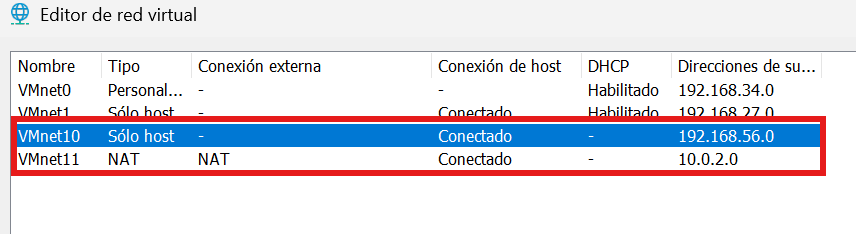
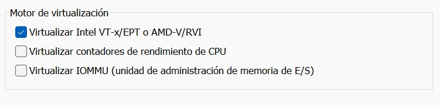

# 03-instalacion-proxmox

# Fase 3. Instalación de Proxmox

## Objetivo
Instalación máquina proxmox y configuración.

## Procedimiento

### 1. Abre VMware en tu equipo y registra su version.
- VMware Workstation Pro 26H1 -->
[Versión VMware](../evidencias/Sesion04_05/capturas-o-salidas/04img1.png)

### 2-3. Crea una VM Linux de 64 bits para Proxmox con CPU, RAM y VDI del diseno.
#### Según: [Requisitos recomendados](./01-inventario-hardware.md#1-puedo-instalar-proxmox-en-este-equipo)
#### Al crear la máquina se le asigna:
- SO: Debian 13x 64 bits --> [Sistema operativo](../evidencias/Sesion04_05/capturas-o-salidas/04img2.jpeg)
- CPU: 1 Procesador, 4 Núcleos --> [Procesadores asignados](../evidencias/Sesion04_05/capturas-o-salidas/04img3.jpeg)
- RAM: 8 GB de RAM --> [RAM Asignada](../evidencias/Sesion04_05/capturas-o-salidas/04img4.jpeg)
- VDI: 64 GB --> [Espacio disco asignado](../evidencias/Sesion04_05/capturas-o-salidas/04img5.jpeg)

### 4. Configura los adaptadores NAT y solo-anfitrion conforme al diseño local.
### Creación adaptadores: Según --> [Diseño de red](./02-diagrama-red.md)
Se usará **VMnet10** para la interfaz ``vmbr0`` y **VMnet11** para la interfaz ``vmbr1``
<br>
[Adaptadores creados según el diseño de red](../evidencias/Sesion04_05/capturas-o-salidas/04img6.png)<br>

Añadimos dos adaptadores de red a la máquina proxmox, uno con **VMnet10** y otro con **VMnet11**.

### 5. Con la VM apagada, habilita virtualizacion anidada si esta disponible y necesitas VMs KVM internas; comprueba luego su funcionamiento real.
### Activar virtualización anidada en VMware
<br>
[Virtualización anidada](../evidencias/Sesion04_05/capturas-o-salidas/04img7.jpeg)

### 6. Monta la ISO autorizada e instala Proxmox dentro del VDI, no sobre el host.
Montamos la ISO de **proxmox** ``(proxmox-ve_9.2-1.iso)`` en la máquina virtual.<br>
[ISO](../evidencias/Sesion04_05/capturas-o-salidas/04img8.jpeg)

**Proxmox instalado:** [Proxmox](../evidencias/Sesion04_05/capturas-o-salidas/04img9.jpeg)

### 7. Configura IP de gestion, hostname y DNS; abre el panel desde el navegador del mismo equipo anfitrion.
Configuramos la dirección IP y el puente al adaptador de red ``VMnet10`` que tiene la red "only-host". El DNS correspondiente y el hostname en /etc/hostname y vinculamos el hostname a mi IP local en /etc/hosts.<br>
[Configuración IP](../evidencias/Sesion04_05/capturas-o-salidas/04img10.jpeg)<br>
[Configuración DNS](../evidencias/Sesion04_05/capturas-o-salidas/04img11.jpeg)<br>

### Entramos al panel desde el equipo anfitrión
[Panel general PROXMOX](../evidencias/Sesion04_05/capturas-o-salidas/04img12.jpeg)
<br>

[Panel Red](../evidencias/Sesion04_05/capturas-o-salidas/04img13.jpeg)

[Panel almacenamiento](../evidencias/Sesion04_05/capturas-o-salidas/04img14.jpeg)

-----------------------------------------------------------------------

# Fase 4. Configuración base del nodo

## Objetivo
Comprobaciones y revisiones

## Procedimiento

### 1. Revisa dónde se guardará cada cosa
[/datacenter/storage](../evidencias/Sesion04_05/capturas-o-salidas/05img3.png)<br><br>
Muestra lo siguiente:
#### local<br>
🟢 Enabled: Yes

    Tipo: Directory

    Ruta: /var/lib/vz

    Contenido admitido:

        Backup

        Import

        ISO image

        Container template

    Uso: guardar imágenes ISO, plantillas y copias de seguridad.

#### local-lvm<br>
🟢 Enabled: Yes

    Tipo: LVM-Thin

    Contenido admitido:

        Disk image

        Container

    Uso: guardar los discos de las máquinas virtuales y contenedores.

> Lo comparamos con los siguientes comandos en la consola del nodo:<br>
[pvesm status](../evidencias/Sesion04_05/capturas-o-salidas/pvesm.txt)<br>
[df -h](../evidencias/Sesion04_05/capturas-o-salidas/inf_discos.txt)

### 2. Relaciona las interfaces con tu diseño
> En Nodo > System > Network


> Comprobando en el nodo:<br>
[ip -br addr](../evidencias/Sesion04_05/capturas-o-salidas/conf_red.txt)<br>
[Ip route](../evidencias/Sesion04_05/capturas-o-salidas/ip_route.txt)

<!-- Esquema red proxmox -->

<div style="display:flex; flex-wrap:wrap; gap:16px; margin:16px 0;">

<div style="flex:1; min-width:230px; background:#e5f5e9; border:1px solid #8ac99c; border-radius:10px; padding:16px; text-align:center; color:#174d2c;">

Adaptador 1: NAT

<h2 style="margin:12px 0; color:#218b4b;">nic0</h2>

<small>Interfaz física virtual</small>

<div style="font-size:24px; margin:8px;">↓</div>

vmbr0

<div style="background:#c5ebd0; border-radius:6px; padding:8px; margin:8px 0; font-weight:bold;">10.0.2.15/24</div>

Gateway: 10.0.2.2

<small>Salida hacia Internet</small>

</div>

<div style="flex:1; min-width:230px; background:#e8f0fc; border:1px solid #9bbbe9; border-radius:10px; padding:16px; text-align:center; color:#194477;">

Adaptador 2: Solo-anfitrión

<h2 style="margin:12px 0; color:#3977c8;">nic1</h2>

<small>Interfaz física virtual</small>

<div style="font-size:24px; margin:8px;">↓</div>

vmbr1

<div style="background:#d1e2fa; border-radius:6px; padding:8px; margin:8px 0; font-weight:bold;">192.168.56.10/24</div>

Sin gateway propio

<small>Comunicación con el anfitrión y laboratorio</small>

</div>

</div>

#### Se han identificado las dos interfaces, sus bridges, las direcciones IP y la puerta de enlace, están correctamente.

### 3. Revisa quién puede administrar el nodo
> **Actualmente solo existe el usuario "root"**

> **Y los siguientes roles:**


### 4. Ajusta el reparto de recursos
> [!IMPORTANT]
> Los datos de hardware cambian respecto al del inventario ya que esos datos se tomaron sobre ordenadores que al final no se usaron

Se ha comprobado el equipo anfitrión dispone de un procesador Intel Core i3-12100 de 4 núcleos y 8 hilos, 16 GiB de RAM y en la máquina virtual disponemos de 64 GB dinámicos:

| Elemento | CPU/vCPU | RAM | Disco o almacenamiento | Motivo del reparto |
|---|---:|---:|---|---|
| **Nodo Proxmox** | Compartida | 2 GiB | 64 GB (disco virtual dinámico) | Sistema operativo, hipervisor y servicios de administración. |
| **srv-aso** | 2 vCPU | 2,5 GiB | 12 GB (`local-lvm`) | Servidor principal del laboratorio. |
| **cli-linux** | 1 vCPU | 2 GiB | 6 GB (`local-lvm`) | Cliente ligero para realizar pruebas de conectividad y servicios. |
| **Plantillas, ISO, copias y margen** | — | Reserva del anfitrión | `local` y almacenamiento externo | Guardar ISO y plantillas, realizar copias externas y evitar saturar el almacenamiento. |

## Comandos usados

```bash
hostnamectl
ip -br addr
pveversion
df -h
pvesm status
```
### Salidas en:
- [hostnamectl](../evidencias/Sesion04_05/capturas-o-salidas/hostname.txt)
- [ip -br addr](../evidencias/Sesion04_05/capturas-o-salidas/conf_red.txt)
- [pveversion](../evidencias/Sesion04_05/capturas-o-salidas/pveversion.txt)
- [df -h](../evidencias/Sesion04_05/capturas-o-salidas/inf_discos.txt)
- [pvesm](../evidencias/Sesion04_05/capturas-o-salidas/pvesm.txt)

## Evidencias

- [Versión VMware](./Sesion04_05/capturas-o-salidas/04img1.png)
- [Sistema operativo](./Sesion04_05/capturas-o-salidas/04img2.jpeg)
- [Procesadores](./Sesion04_05/capturas-o-salidas/04img3.jpeg)
- [RAM](./Sesion04_05/capturas-o-salidas/04img4.jpeg)
- [Espacio Disco duro](./Sesion04_05/capturas-o-salidas/04img5.jpeg)
- [Adaptadores de red](./Sesion04_05/capturas-o-salidas/04img6.png)
- [Virtualización anidada](./Sesion04_05/capturas-o-salidas/04img7.jpeg)
- [ISO](./Sesion04_05/capturas-o-salidas/04img8.jpeg)
- [Proxmox interfaz de comandos](../evidencias/Sesion04_05/capturas-o-salidas/04img9.jpeg)
- [Configuración IP](../evidencias/Sesion04_05/capturas-o-salidas/04img10.jpeg)
- [Configuración DNS](../evidencias/Sesion04_05/capturas-o-salidas/04img11.jpeg)
- [Panel Red](../evidencias/Sesion04_05/capturas-o-salidas/04img13.jpeg)
- [Panel almacenamiento](../evidencias/Sesion04_05/capturas-o-salidas/04img14.jpeg)
- [Mejora1](../evidencias/Sesion04_05/capturas-o-salidas/05img1.png)
- [Mejora2](../evidencias/Sesion04_05/capturas-o-salidas/05img2.png)
- [/datacenter/storage](../evidencias/Sesion04_05/capturas-o-salidas/05img3.png)
- [network](../evidencias/Sesion04_05/capturas-o-salidas/05img4.png)
- [usuarios](../evidencias/Sesion04_05/capturas-o-salidas/05img5.png)
- [roles](../evidencias/Sesion04_05/capturas-o-salidas/05img6.png)
- [hostnamectl](../evidencias/Sesion04_05/capturas-o-salidas/hostname.txt)
- [conf_red](../evidencias/Sesion04_05/capturas-o-salidas/conf_red.txt)
- [pveversion](../evidencias/Sesion04_05/capturas-o-salidas/pveversion.txt)
- [inf_disco](../evidencias/Sesion04_05/capturas-o-salidas/inf_discos.txt)
- [pvesm](../evidencias/Sesion04_05/capturas-o-salidas/pvesm.txt)
- [Ip route](../evidencias/Sesion04_05/capturas-o-salidas/ip_route.txt)

## Incidencias
Como windows dió muchos problemas, al final se tomó la decisión de rehacer la máquina Proxmox en el ordenador con Linux de clase. La fase 4 ya se realizó en el nuevo proxmox y las configuraciones de esta nueva máquina fueron exactamente las mismas que las que se hicieron en Vmware en windows en la Fase 3.

## Conclusion
Se ha creado la máquina y los adaptadores de red, se ha instalado proxmox y configurado con éxito. Se accedió al panel de Proxmox desde el sistema anfitrión y se confirmó la conexión. Se comprobo y revisó las configuraciones.

----------------------------------------------------

[Volver al indice](../README.md)